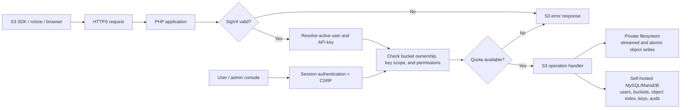

<div align="center">

# php-s3

### The self-hosted S3-compatible object storage server that runs on shared hosting

[](LICENSE)
[](https://php.net)
[](https://php-s3.codaipro.com/docs/usage)
[](https://php-s3.codaipro.com/docs/s3-compatibility)
[](#features)

**Amazon S3 API — SigV4, multipart, presigned URLs, `aws-chunked` streaming — as a plain
PHP app you deploy like WordPress: upload, open the installer, point your AWS SDK at it.**

No Go binary. No Docker. No root. No daemon. No Composer dependencies at runtime.
Just PHP 8.1+ and MySQL/MariaDB on any Apache, LiteSpeed or cPanel shared host.
php-s3 is open-source software you install and operate on your own hosting account.
It does not require a php-s3 managed storage service or external queue/cache service.

[Why php-s3](#why-not-just-use-minio-or-anything-else) • [Features](#features) • [Quick start](#quick-start) • [S3 API coverage](#s3-api-coverage) • [Comparison](#how-php-s3-compares) • [Docs](#documentation)

</div>

---

## Why not just use MinIO (or anything else)?

Because MinIO needs a server you control — a Go binary, a long-running process, a port
to bind — and your $5/month cPanel plan can't give you any of that. And because the
other PHP S3 servers each fail a different way:

| You want… | The catch elsewhere | php-s3 |
|---|---|---|
| S3 on **shared hosting** (cPanel, LiteSpeed, no root) | MinIO/others need a server you administer | ✅ Plain `public/index.php` + `.htaccess`, install via browser |
| Signatures that are **actually verified** | lite-s3 parses SigV4 but the wired path never checks it (see [research](https://php-s3.codaipro.com/docs/research)) | ✅ Strict SigV4 — header + presigned + per-chunk chain, `hash_equals`, **no bypass flags** |
| Uploads of **big files in constant memory** | simple-php-s3-server buffers whole PUT bodies in RAM | ✅ Everything is a 64 KiB streaming loop, hash-while-writing |
| Listings that don't degrade | buckie/simple-php re-scan the directory per list page — O(n) | ✅ DB is the index; sharded object layout, pagination stays fast |
| Real S3 semantics (XML API, AWS error codes, composite ETags) | buckie-php isn't S3 at all; lite-s3's ETags aren't AWS-format | ✅ Spec-shaped: `md5(...)-N` multipart ETags, AWS error taxonomy |
| A project you can **read and audit** | heavyweight options hide behind frameworks | ✅ Framework-free layered core, research + architecture docs published with the project |

And unlike [opsfour/s3-server](https://github.com/opsfour/s3-server) — the best-in-class
PHP S3 server, which we openly credit as our quality bar — php-s3 doesn't require
PHP 8.4, Amp fibers and long-running workers. **Same correctness bar, deployable where
shared hosting exists.**

## How php-s3 compares

Fair summary of the four open-source PHP projects we studied in full source before
writing a line of code (audit: [project research](https://php-s3.codaipro.com/docs/research)):

| Capability | **php-s3** | [opsfour/s3-server](https://github.com/opsfour/s3-server) | [simple-php-s3-server](https://github.com/hochenggang/simple-php-s3-server) | [lite-s3](https://github.com/nityam2007/lite-s3) | [buckie-php](https://github.com/dynamiatools/buckie-php) |
|---|:-:|:-:|:-:|:-:|:-:|
| Real S3 XML API + SigV4 | ✅ | ✅ | ✅ | ⚠️ | ❌ |
| Signature verified on every request | ✅ | ✅ | ⚠️ | ❌ | n/a |
| Runs on shared hosting (PHP 8.1, no daemon) | ✅ | ❌ | ✅ | ✅ | ✅ |
| Streaming PUT/GET (constant memory) | ✅ | ✅ | ❌ | ⚠️ | ✅ |
| DB-indexed listings (no full scans) | ✅ | ✅ | ❌ | ✅ | ❌ |
| Multipart with AWS-format ETag | ✅ | ✅ | ✅ | ⚠️ | ❌ |
| Presigned URLs (GET/PUT, expiry) | ✅ | ✅ | ⚠️ | ⚠️ | ❌ |
| `aws-chunked` + per-chunk signatures | ✅ | ✅ | ❌ | ❌ | ❌ |
| Automated tests in the repo | ✅ 239 | ✅ 745 | ⚠️ | ❌ | ✅ 56 |
| Web installer + admin panel | ✅ | ❌ | ❌ | ✅ | ❌ |
| Runtime dependencies | **0** | Amp + Symfony | 2 packages | 0 | 0 |

✅ supported & proven · ⚠️ partial or broken · ❌ not supported

## Features

- **S3-compatible API** — buckets, objects, `ListObjectsV1/V2` (prefix, delimiter,
  continuation tokens), `DeleteObjects` batch, Range/206 for video seeking, `CopyObject`
- **AWS Signature Version 4** — header mode and presigned URLs (1–604800 s expiry),
  ±900 s skew, `host` required in SignedHeaders, constant-time comparison, payload hash
  verified against the streamed body
- **`aws-chunked` streaming uploads** — signed chunk chains and unsigned-trailer framing,
  verified per chunk; tampered chunks rejected with `SignatureDoesNotMatch`
- **Multipart uploads** — create / uploadPart / complete / abort / listUploads / listParts,
  AWS-format composite ETags, 5 MiB minimum-part enforcement (`EntityTooSmall`)
- **Streaming everything** — bodies are pumped in 64 KiB chunks while MD5/SHA-256 are
  computed on the fly; nothing ever loads a whole object into memory
- **Safe storage layout** — `sha256(key)`-sharded paths + UUID names: object keys never
  touch the filesystem path (traversal becomes structurally impossible), one directory
  never holds millions of entries, data root lives outside the web root
- **Shared-hosting plumbing** — `public/` docroot, `.htaccess` with the Authorization
  header passthrough SigV4 needs (Apache/LiteSpeed), dotfiles blocked, web installer
- **Multi-user consoles** — private buckets, user/admin roles, quota-aware uploads,
  bucket-scoped API keys, audit logs, and account/session controls
- **File manager and sharing** — browser uploads, copy/download/delete, and temporary
  signed links that can be shared without making a bucket public
- **Minimal admin** — session login with throttling, access-key management, bucket
  overview, usage stats, audit log
- **CLI** — `migrate`, `gc` (expired uploads + orphan temp files), `key:create`, `doctor`
- **Honest errors** — AWS error taxonomy with correct HTTP statuses + `RequestId`, so
  boto3, rclone and the AWS SDK fail gracefully instead of mysteriously
- **Zero runtime dependencies** — PHP ≥ 8.1 + `pdo_mysql`, `openssl`, `fileinfo`, `mbstring`.
  PHPUnit/AWS SDK are dev-only.

## S3 API coverage

A feature counts as supported only when a test proves it through a real client:

| Area | Operations |
|---|---|
| Service | `ListBuckets`, `GET /_health` |
| Buckets | `CreateBucket`, `DeleteBucket` (empty only), `HeadBucket` |
| Objects | `PutObject`, `GetObject` (+ Range/206), `HeadObject`, `DeleteObject`, `CopyObject`* |
| Listing | `ListObjectsV1`, `ListObjectsV2` (prefix, delimiter/CommonPrefixes, markers, tokens) |
| Batch | `DeleteObjects` (≤1000 keys, Quiet mode) |
| Multipart | `CreateMultipartUpload`, `UploadPart`, `CompleteMultipartUpload`, `AbortMultipartUpload`, `ListMultipartUploads`, `ListParts` |
| Auth | SigV4 header, presigned query URLs, `aws-chunked` streaming |
| Next | checksum headers, conditional requests, boto3 suite, rclone docs |

\* routed and implemented; end-to-end proof pending.

Full matrix with evidence: **[S3 compatibility guide](https://php-s3.codaipro.com/docs/s3-compatibility).**

## Requirements

- PHP **8.1+** with `pdo_mysql`, `openssl`, `fileinfo`, `mbstring`
- MySQL 5.7+ / MariaDB 10.3+ (any DB PDO can reach; migrations are portable)
- Apache / LiteSpeed / nginx / Caddy, or PHP's built-in server for development
- No Composer needed on the server (install with `--no-dev`, or upload `vendor/` from a dev machine)

## Quick start

### Shared hosting (cPanel / LiteSpeed / any PHP host)

```bash
git clone https://github.com/Luckyyaduvanshiofficial/php-s3.git
cd php-s3
composer install --no-dev        # or copy vendor/ from your dev machine
```

1. Point your domain (or subdomain) document root at `public/`
2. Visit `https://your-domain.example/install` and enter the MySQL database name,
   username, password, then your admin username and password. The installer builds the
   MySQL connection settings and chooses a private data directory automatically.
3. Log in as administrator and create a user with a storage quota
4. Sign in as the user, create a private bucket, and create a bucket-scoped API key
5. Point any S3 client at your domain — **path-style**, custom endpoint

The user **File Manager** lets account owners upload, copy, download, and delete their
objects. Create a temporary one-hour share link for a file; it is signed with an enabled,
read-authorized key scoped to that bucket. For S3 client setup, open **Connect** to copy
the endpoint and configuration examples. No file or database is sent to a php-s3 service.

### Local development

```bash
git clone https://github.com/Luckyyaduvanshiofficial/php-s3.git
cd php-s3
composer install
php -S 127.0.0.1:8099 -t public public/index.php
# open http://127.0.0.1:8099/install
```

### Use it with the official AWS SDK for PHP

```php
use Aws\S3\S3Client;

$s3 = new S3Client([
    'version' => 'latest',
    'region'  => 'us-east-1',
    'endpoint' => 'https://your-domain.example',   // your php-s3 URL
    'use_path_style_endpoint' => true,             // required (path-style)
    'credentials' => [
        'key'    => 'AKIA...',
        'secret' => '...',
    ],
]);

$s3->createBucket(['Bucket' => 'media']);
$s3->putObject([
    'Bucket' => 'media',
    'Key'    => 'video.mp4',
    'SourceFile' => __DIR__ . '/video.mp4',
]);

// Multipart, ranged downloads and presigned URLs work unchanged:
$cmd = $s3->getCommand('GetObject', ['Bucket' => 'media', 'Key' => 'video.mp4']);
$url = (string) $s3->createPresignedRequest($cmd, '+1 hour')->getUri();
```

## Architecture

```
                       ┌────────────────────────────────────────────┐
   S3 client ──HTTP──► │ public/index.php  (only web-reachable file)│
  (SDK, rclone, …)     └──────────────┬─────────────────────────────┘
                                      ▼
        ┌──────────────┬──────────────┼──────────────┬───────────────┐
        ▼              ▼              ▼              ▼               ▼
   Http/Request   Auth/SigV4     S3/Operation    Admin panel     XML/Error
   (only layer      (header +     resolver ──►  (session auth,   (AWS taxonomy,
    touching        presigned +    dispatches    keys, usage)     XXE-safe)
    $_SERVER)       aws-chunked)   to handlers
                                      ▼
                          S3/Handlers ──► Storage/ (streaming put/get,
                                          sharded FS + MySQL index)
```

The following Mermaid flow is the request and storage path from the Tldraw architecture:



All runtime components are part of the application and the operator's hosting account:
PHP, MySQL/MariaDB, the private data directory, and the web server. The owner supplies
and administers those resources; php-s3 does not provide hosted storage.

- **One stack, one entrypoint** — no framework, no middleware maze, one request path
- **Transport-agnostic core** — nothing outside `Http/` reads `$_SERVER`; auth, XML,
  routing and errors are pure functions over strings/arrays
- **Staging + atomic rename** — objects become visible only when fully written
- Full design rationale: **[Architecture](https://php-s3.codaipro.com/docs/architecture)** ·
  source audit of the four reference projects: **[Research](https://php-s3.codaipro.com/docs/research)**

## Diagrams

**Platform navigation** — user console vs admin console map, in front of the SigV4 S3 API.


**User onboarding** — register, sign in, create bucket, scoped key, configure client, upload.


**Bucket management** — object browser, settings, private by default, delete only when empty.


**Admin operations** — dashboard, users, storage, security, system settings.


**S3 authorization pipeline** — verify SigV4, resolve principal, enforce permissions, audit.


**Shared hosting deployment** — PHP app, MySQL, private filesystem, HTTPS domain.


## Security

- Strict SigV4 with **no bypass flags and no "simple auth" mode** — every S3 request signed
- Account sessions and S3 credentials both require active accounts; bucket ownership,
  key bucket scopes, and read/write permissions are enforced on the server
- Permission checked **before** existence (403 ≠ 404, anti-enumeration)
- `hash_equals` for every signature, secret, and ETag comparison
- Bucket-name grammar + segment-based key canonicalization + `^[a-f0-9]{32}$` uploadId
  whitelist — traversal defense by validation, not by sanitizing after the fact
- XXE-safe XML (`DOCTYPE`/`ENTITY` rejected before parse, `LIBXML_NONET`, 8 MiB cap)
- Objects stored outside the web root; engine-off rules for data dirs; dotfiles denied
- Login throttling + audit log in the admin panel; secrets shown once, at creation

## CLI

```bash
php cli/php-s3.php migrate              # apply schema migrations (idempotent)
php cli/php-s3.php doctor               # environment / config health check
php cli/php-s3.php gc                   # purge expired multipart uploads + temp files
php cli/php-s3.php key:create --owner=1 --buckets='*' --description=ci
```

## Testing

```bash
composer test            # PHPUnit unit and integration suites
composer test:all         # PHPUnit + PHP syntax checks
```

To include a live S3 API smoke test, point it at a disposable test instance and use
an access key allowed to create and delete buckets and objects. The smoke test creates
a uniquely named temporary bucket and removes it when finished:

```bash
PHP_S3_E2E=1 \
PHP_S3_ENDPOINT=https://s3.example.test \
PHP_S3_ACCESS_KEY_ID=your-test-key \
PHP_S3_SECRET_ACCESS_KEY=your-test-secret \
composer test:all
```

The live smoke test checks bucket creation, put/get/head, ListObjectsV2, CopyObject,
multipart upload, batch deletion, and cleanup. Do not point it at a production bucket
or use production credentials.

The compatibility claims are backed by a live end-to-end harness that drives a running
server with the **real `aws/aws-sdk-php`** plus raw-wire SigV4/aws-chunked probes
(presign expiry, multipart ETags, tampered-chunk rejection). Operation-by-operation
evidence lives in the [S3 compatibility guide](https://php-s3.codaipro.com/docs/s3-compatibility).

## Project status & roadmap

| Phase | Scope | Status |
|---|---|---|
| 1 · Research | Full source audit of 4 reference projects | ✅ [Research](https://php-s3.codaipro.com/docs/research) |
| 2 · Architecture | Design decisions recorded before code | ✅ [Architecture](https://php-s3.codaipro.com/docs/architecture) |
| 3 · MVP | SigV4, buckets, objects, ranges, listing, installer, CLI | ✅ shipped |
| 4 · S3 compatibility | Presigned, DeleteObjects, multipart, aws-chunked | ✅ shipped · [matrix](https://php-s3.codaipro.com/docs/s3-compatibility) |
| 5 · Hardening | S3 rate limits, quotas, CORS, public-read policy, recovery | 🚧 in progress |
| 6 · Documentation | Deployment guides, boto3/rclone suites, SDK matrix CI | 🚧 next |

**Contributions welcome** — especially: boto3 compatibility suite, rclone/AWS CLI smoke
docs, `x-amz-checksum-*`, conditional requests, CI workflow.

## Documentation

- [S3 compatibility](https://php-s3.codaipro.com/docs/s3-compatibility) — operation-by-operation support matrix with evidence
- [Architecture](https://php-s3.codaipro.com/docs/architecture) — system design, storage layout, and auth flow
- [Research](https://php-s3.codaipro.com/docs/research) — source audits and attribution
- [CHANGELOG-style commit history](https://github.com/Luckyyaduvanshiofficial/php-s3/commits/main) — small, genuine, reviewable commits

## Contributing

1. Fork & create a feature branch (`feat/…`, `fix/…`, `docs/…`)
2. Keep the rules: zero runtime dependencies · no `$_SERVER` outside `Http/` ·
   no bypass flags in auth · features ship with a test that proves them end-to-end
3. `composer test` must stay green; keep commits small and honest
4. Open a PR

## License

[Apache-2.0](LICENSE) © 2026 codaipro — Lucky Yaduvanshi.

Built on ideas (never copied code) from a line of open-source projects — our thanks:

- [delight-im/PHP-Auth](https://github.com/delight-im/PHP-Auth) (MIT) — password/session primitives adapted for the admin panel
- [opsfour/s3-server](https://github.com/opsfour/s3-server), [simple-php-s3-server](https://github.com/hochenggang/simple-php-s3-server),
  [lite-s3](https://github.com/nityam2007/lite-s3), [buckie-php](https://github.com/dynamiatools/buckie-php) —
  studied in full; attribution and research notes are in the [project documentation](https://php-s3.codaipro.com/docs/research)

S3-compatible is a description of API behavior. php-s3 is not affiliated with,
endorsed by, or connected to Amazon Web Services.
